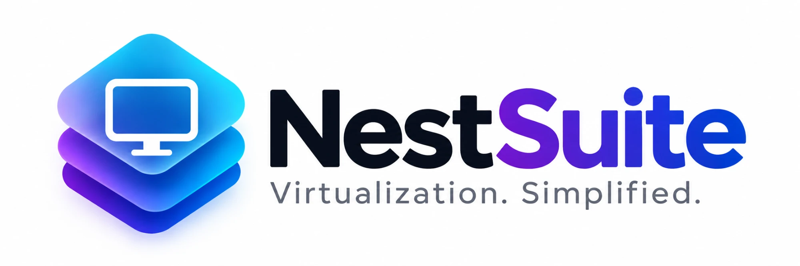
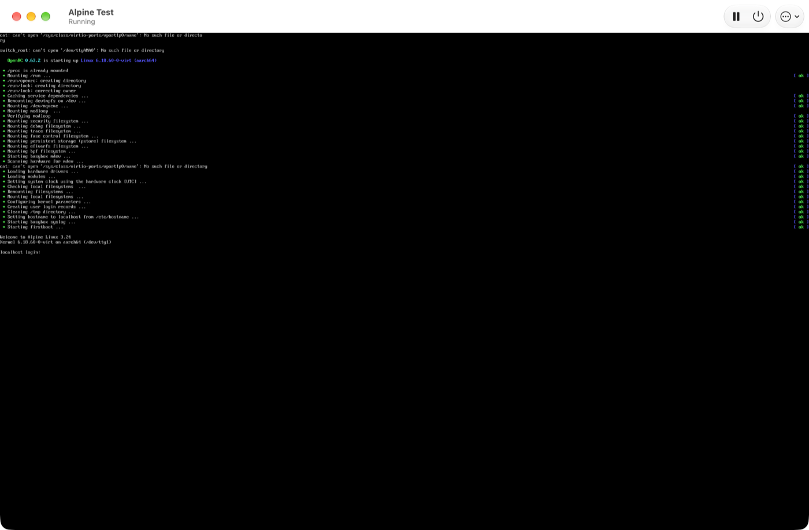
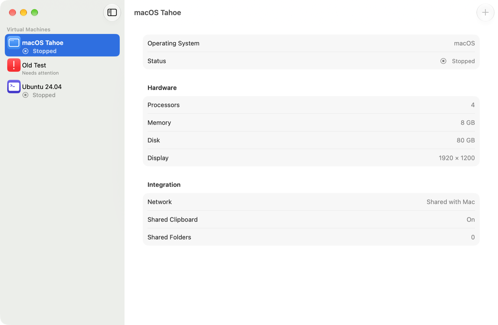

<p align="center">
  
</p>

<p align="center">
  <strong>Run Linux and macOS side by side with your Mac apps — free, open source, and built on Apple’s own virtualization stack.</strong>
</p>

<p align="center">
  <a href="https://github.com/brommet87/NestSuite/actions/workflows/ci.yml"></a>
  <a href="LICENSE"></a>
  
  
</p>

---

NestSuite is a virtualization app for the Mac, made for developers and everyday users alike:
guided setup, shared folders and clipboard, declarative machine definitions, instant clones and
snapshots, and a scriptable command line — as a transparent, auditable open-source project.

It is built directly on Apple’s public `Virtualization.framework` and `Hypervisor.framework`.

> [!IMPORTANT]
> NestSuite is in **early development**. Linux machines can be created, installed from an ARM64
> installer image and run — in the app and from the command line. macOS machines and many comfort
> features are still ahead. See the [roadmap](ROADMAP.md).

<p align="center">
  
</p>

<p align="center">
  
</p>

## What works today

| Area | Status |
|---|---|
| VM library (`.nestvm` bundles, damaged-bundle recovery, Move to Trash) | ✅ 0.1 |
| Configuration model with host-aware validation | ✅ 0.1 |
| `Nestfile.yml` — declarative machines with line-numbered errors | ✅ 0.1 |
| `nestctl` — list, inspect, validate, clone, snapshot, rm; JSON output, exit codes | ✅ 0.1 |
| Linked clones and snapshots with branching (APFS copy-on-write) | ✅ 0.1 |
| Design system, English + German UI, VoiceOver labels | ✅ 0.1 |
| Create and run Linux machines from any ARM64 installer ISO — app and `nestctl run` | ✅ 0.2 |
| Display window with auto-resize, pause/resume, clean shutdown, safe quit | ✅ 0.2 |
| 30 official images from 15 distributions, checksum-verified; ready in about a minute with cloud-init | ✅ 0.2 |
| `nestctl up` from a Nestfile: user, SSH keys, shared folders, Rosetta — set up automatically | ✅ 0.2 |
| Shared folders and Rosetta verified in Debian, Ubuntu and AlmaLinux guests | ✅ 0.2 |
| macOS machines | 🗺️ 0.3 |
| Isolated machines for untrusted code and coding agents, SSH, daemon, HTTP API, MCP server | 🗺️ 0.3–0.5 |
| `name.nest.local` with automatic HTTPS, port forwarding, file events for hot-reload | 🗺️ 0.5–0.6 |
| OCI image push/pull, containers, Kubernetes | 🗺️ 0.7–0.9 |
| Seamless windows (guest apps as Mac windows) | 🗺️ planned |
| Windows 11 on Arm via NestSuite’s own VMM | 🗺️ planned |

## Requirements

- A Mac with Apple silicon for macOS guests and Rosetta (Intel Macs: Linux guests only)
- macOS 15 Sequoia or later
- To build: Xcode 16 or later

## Building from source

```bash
git clone https://github.com/brommet87/NestSuite.git
cd NestSuite
make bootstrap   # installs XcodeGen, SwiftLint, SwiftFormat via Homebrew
make run         # generates the Xcode project, builds and launches the app
```

Useful tasks: `make test` (all tests), `make lint`, `make format`. Run `make help` for the full list.
Details: [docs/DEVELOPMENT.md](docs/DEVELOPMENT.md).

Local builds are ad-hoc signed with the `com.apple.security.virtualization` entitlement; no Apple
Developer account is needed to develop.

## For developers

```yaml
# Nestfile.yml — commit it next to your code
version: 1
machines:
  dev:
    guest: linux
    image: ubuntu-24.04
    memory: 8GiB
    shares: [{ host: ., tag: workspace }]
    ports: [3000]
```

```bash
nestctl create dev --memory 8GiB --share .:workspace
nestctl run dev --iso ubuntu-arm64.iso --console   # install Linux right in the terminal
nestctl validate --strict          # CI-friendly, exit code 65 on problems
nestctl clone ubuntu-base ci --count 20   # instant disposable machines
nestctl snapshot create dev before-upgrade
nestctl list --json | jq '.[].name'
```

```bash
nestctl up        # creates the machines from official images and starts them
```

See the [CLI reference](docs/cli.md), [Nestfile reference](docs/nestfile.md) and [images](docs/images.md).

## Documentation

- [Architecture](docs/ARCHITECTURE.md) — modules, data flow, concurrency model
- [Architecture decisions](docs/adr/) — why things are the way they are
- [Design system](docs/design/) — principles, tokens, components, voice & tone, accessibility
- [CLI](docs/cli.md) · [Nestfile](docs/nestfile.md) · [Images](docs/images.md) · [Testing](docs/TESTING.md) · [Releasing](docs/RELEASING.md)

## Contributing

Contributions are welcome — code, design, translations, documentation and bug reports. Please read
[CONTRIBUTING.md](CONTRIBUTING.md) and our [Code of Conduct](CODE_OF_CONDUCT.md). Security issues:
see [SECURITY.md](SECURITY.md), please don’t open public issues for them.

## License

NestSuite is free software under the [GNU General Public License v3.0 or later](LICENSE).

Not affiliated with Apple or any other vendor. All trademarks belong to their owners.
